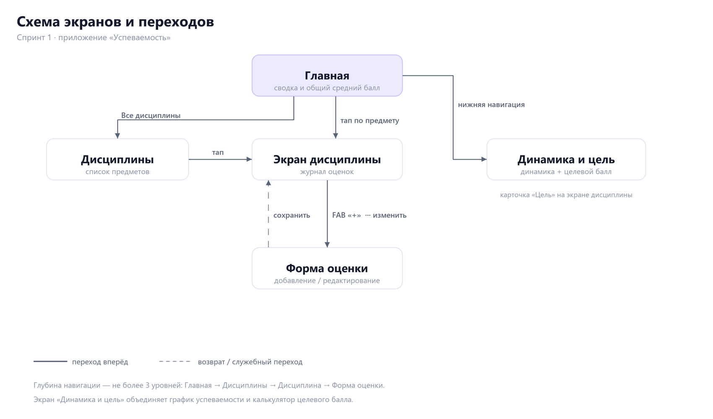

# Экраны и навигация

## 1. Перечень экранов

| ID | Экран | Назначение и ключевые элементы |
|---|---|---|
| S1 | Главная | Общий средний балл крупной карточкой, количество оценок и дисциплин, три дисциплины сводки, последние оценки, кнопка «Добавить оценку», нижняя навигация |
| S2 | Дисциплины | Поиск по названию, список предметов с преподавателем, количеством оценок и средним баллом, метка «риск», FAB добавления |
| S3 | Журнал дисциплины | Средний балл и цель, фильтры по виду работы и периоду, сортировка, список оценок (дата, вид работы, значение, комментарий), меню записи, FAB |
| S4 | Форма оценки | Добавление и редактирование: дисциплина, оценка 2–5, дата, вид работы, комментарий; подсказки и ошибки; «Сохранить» / «Отмена» |
| S5 | Динамика и цель | График среднего балла по месяцам, выбор цели, расчёт необходимой оценки, сообщение о достижимости, средние по дисциплинам |

Схема переходов: 

## 2. Правила навигации

* Нижняя навигация: «Главная», «Дисциплины», «Динамика». Переходы внутри раздела идут
  стеком: возврат из журнала ведёт в список дисциплин, а не на главную.
* Глубина навигации — не более трёх уровней: Главная → Дисциплины → Дисциплина → Форма.
* Форма оценки одна для добавления (FAB «+») и редактирования (меню «···»); отличается
  заголовок и наличие исходных значений.
* Удаление оценки и дисциплины — только после подтверждения. Для дисциплины диалог
  сообщает количество удаляемых оценок.
* Пустые состояния содержат пояснение и кнопку первого действия.
* Введённые в форму данные и состояние экрана переживают поворот устройства
  (SavedStateHandle). «Назад» на главной закрывает приложение.

## 3. Состояния интерфейса

| Состояние | Экран | Как показано |
|---|---|---|
| Нет ни одной оценки | S1, S3 | «Оценок пока нет» + пояснение и кнопка действия |
| Нет дисциплин | S2 | «Добавьте первый предмет» + FAB |
| Низкий средний балл | S1, S2 | Метка «риск» и цветной бейдж, не только цвет |
| Ошибка ввода | S4 | Сообщение под полем: «Оценка должна быть от 2 до 5» |
| Цель недостижима | S5 | Отдельный блок: «нужно 6,2 — цель недостижима одной оценкой» |
| Длинное название | S2, S3 | Перенос на две строки без обрезки и наложения бейджа |

## 4. Прототипы

| Файл | Экран |
|---|---|
| `prototypes/overview.png` | все пять экранов на одном листе |
| `prototypes/01_home.png` | S1 «Главная» |
| `prototypes/02_disciplines.png` | S2 «Дисциплины» |
| `prototypes/03_discipline.png` | S3 «Журнал дисциплины» |
| `prototypes/04_edit_form.png` | S4 «Форма оценки» |
| `prototypes/05_dynamics.png` | S5 «Динамика и цель» |

Прототипы выполнены в размере 1080×2160 px, светлая тема, сетка 8 dp.

## 5. Дизайн-токены

| Токен | Значение | Использование |
|---|---|---|
| Основной цвет | `#4F46E5` | карточка среднего балла, активные элементы, FAB |
| Фон | `#F5F6FA` | фон экранов |
| Карточка | `#FFFFFF`, радиус 24–32, обводка `#E4E7F2` | списки и блоки |
| Текст | `#151A2D` / `#5A6478` / `#8B93A7` | заголовки / пояснения / подписи |
| Успех | `#0F9D76` | оценки 5, достижимая цель |
| Риск | `#B45309` / `#C0392B` | низкий средний балл, оценки 2–3 |
| Шрифт | системный sans-serif, 12–52 sp | весь интерфейс |
